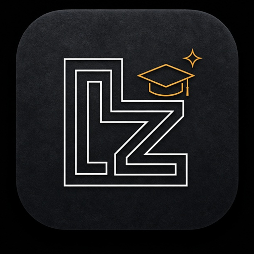
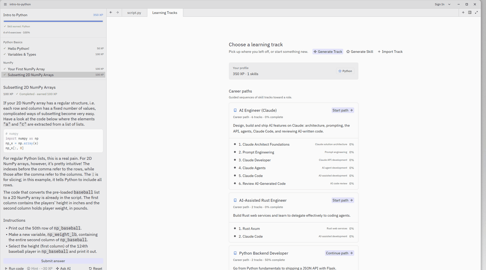
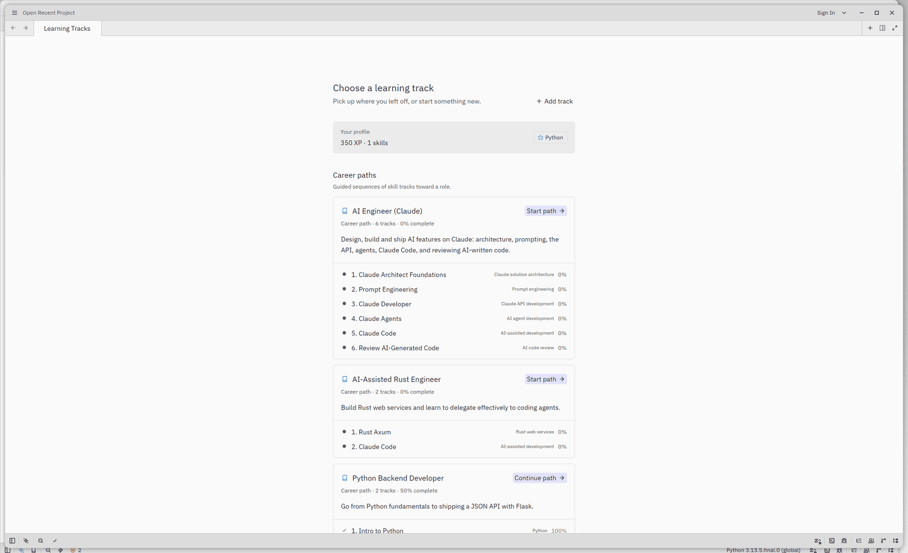
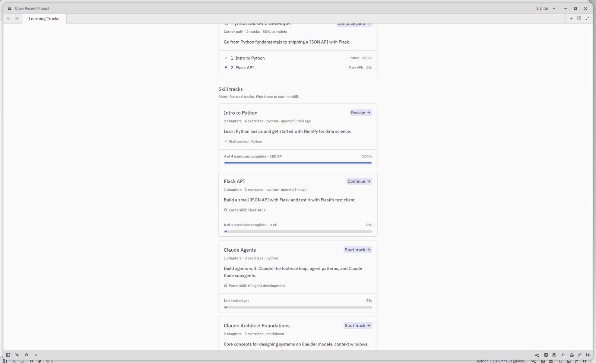
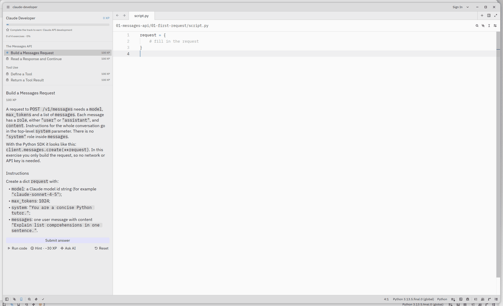
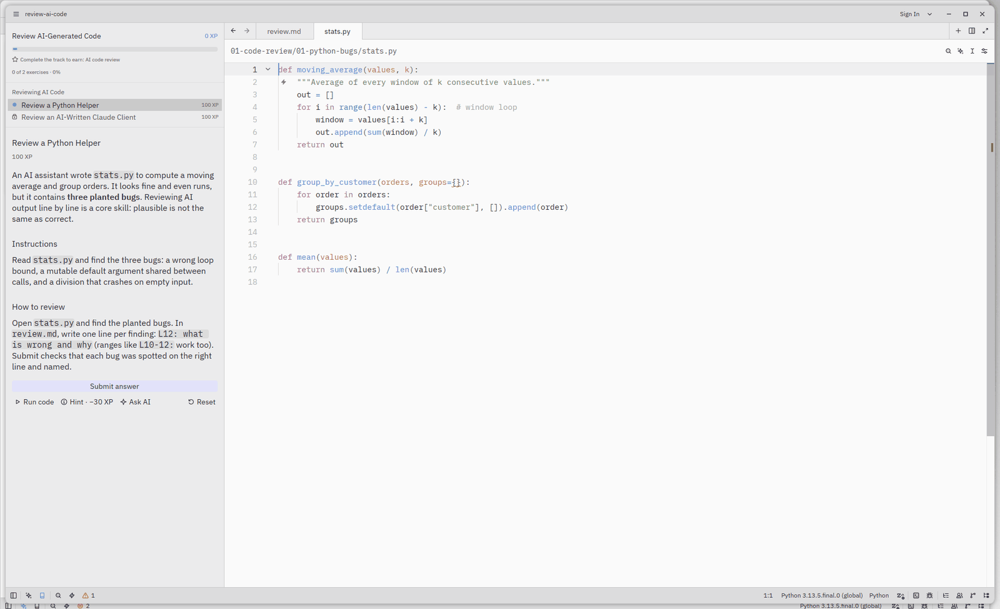
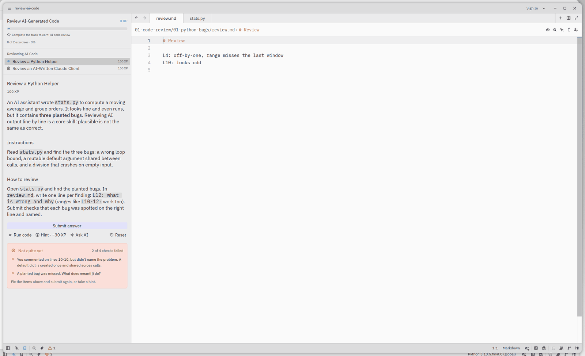
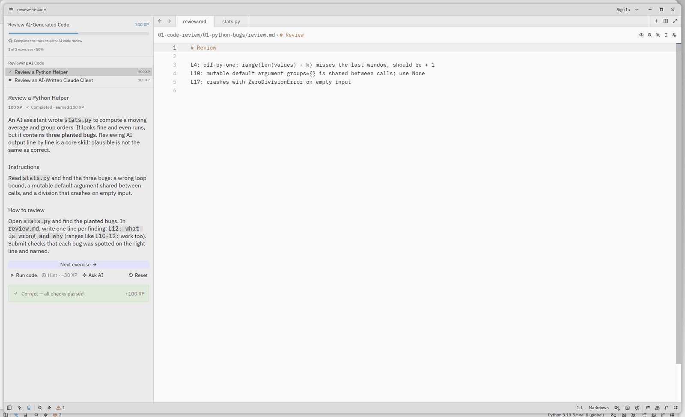
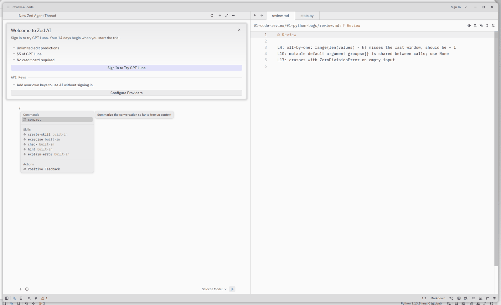
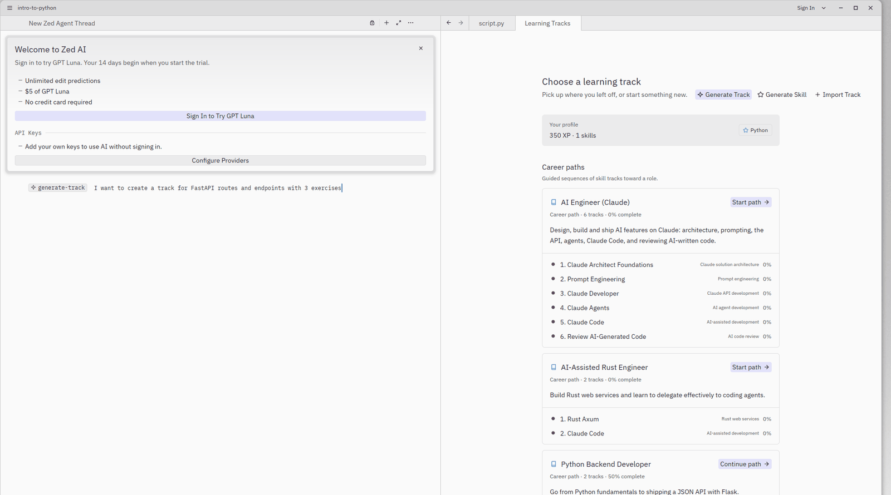

<p align="center">
  
</p>

<h1 align="center">LearnZed</h1>

<p align="center"><b>Learn to code by writing real code in a real editor.</b></p>

<p align="center"></p>

LearnZed is an interactive learning app, similar to DataCamp, built on top of the [Zed](https://zed.dev) editor. You pick a **career path** or a **skill track** and work through short exercises inside a full code editor. **Run** your code to try it, then **Submit** it for an automated check. You earn **XP**, can unlock **hints** (they cost XP), and finishing a track gives you a **skill**. When you're stuck, **Ask AI** sends the exercise to Zed's agent, or to your own agent such as Claude Code. The agent can also **generate a new track** for you.

> Status: MVP / work in progress. Lives on the `learn/main` branch.

## Features

### Career paths and skill tracks

Career paths are ordered sequences of tracks toward a role: *AI Engineer (Claude)*, *AI-Assisted Rust Engineer* and *Python Backend Developer*. Skill tracks are short and focused. Finishing one earns its skill.

Bundled tracks: *Intro to Python* (with NumPy), *Flask API*, *Rust Axum*, plus the Claude tracks: *Claude Architect Foundations*, *Prompt Engineering*, *Claude Developer* (Messages API, tool use), *Claude Agents*, *Claude Code* (CLAUDE.md, permissions, MCP config) and *Review AI-Generated Code*. Claude exercises are checked offline against mock data, so they need no API key.

 

### Exercises with Run and Submit

The Learn panel shows the context, instructions and hints, with *Run code*, *Submit answer*, *Hint* and *Ask AI* buttons. Each exercise ships a `check.py` that inspects your output and code and returns friendly feedback. Layouts are `focused` (just the exercise file) or `project` (file tree shown, for multi-file work).



### Code review exercises

Exercises with `kind = "review"` give you plausible-looking code with planted bugs. You write findings in `review.md` as `L12: what is wrong and why`. Submit checks that each bug was spotted on the right line and named.



 

### Ask AI and slash commands

*Ask AI* opens Zed's agent panel with the exercise context. It gives hints and explanations, not the solution. If no AI provider is connected, LearnZed asks you to connect one. Each track workspace gets a `.rules` file with tutor guidelines. The agent also has learning tools and the built-in skills `/exercise`, `/check`, `/hint` and `/explain-error`.



### Generate Track and Generate Skill

*Generate Track* and *Generate Skill* in the picker start a short AI interview in the agent chat about your goals, level, stack and time budget. The agent then generates a track, validates it with the track parser and checker, and adds it to the picker. *Import Track* loads a track from a local folder.



Progress (XP, completed exercises and skills) is saved locally.

LearnZed keeps its config and data in separate `learnzed` directories, so it never touches an existing Zed install. The binary is called `learnzed`.

## Download

Prebuilt **unsigned** builds are attached to [GitHub Releases](https://github.com/ndolinschi/lzed/releases):

- Linux x86_64: `learnzed-linux-x86_64.tar.gz`
- macOS Apple Silicon: `learnzed-macos-aarch64.tar.gz` (unsigned, so run `xattr -dr com.apple.quarantine learnzed` before the first launch)
- Windows x86_64: `learnzed-windows-x86_64.zip` (unsigned, so SmartScreen may warn)

Exercises need Python 3 with `numpy`. Releases are built by `.github/workflows/learnzed_release.yml` when a `v*` tag is pushed.

## Quick start

Requirements: a Rust toolchain (via rustup), Zed's usual [build dependencies](docs/src/development), and **Python 3 with `numpy`** for the exercise checker (`pip install numpy`).

```sh
git clone -b learn/main https://github.com/ndolinschi/lzed.git
cd lzed
cargo run            # dev build, launches the track picker
```

Or run the dev binary directly with a throwaway data dir:

```sh
cargo build
ZED_ALLOW_EMULATED_GPU=1 target/debug/learnzed --user-data-dir /tmp/lz-data
```

(`ZED_ALLOW_EMULATED_GPU=1` is only needed on machines without a GPU.)

Run the learning core tests with `cargo test -p learn`.

## Track format

Bundled tracks live in `crates/learn/tracks/`, and career paths in `crates/learn/careers/`.

```
my-track/
  track.toml                # id, title, version, language, description, skill
  01-basics/
    chapter.toml            # title, order
    01-hello/
      exercise.toml         # id, title, xp, kind, language, file, hint_xp_cost, layout
      context.md            # background shown above the task
      instructions.md       # what to do
      hints.md              # hints, revealed one at a time
      starter.py            # initial contents of the exercise file
      solution.py           # reference solution
      setup.py              # optional pre-exercise code
      check.py              # automated checks (review exercises use bugs.toml + review_file instead)
```

`exercise.toml` defaults: `xp = 100`, `kind = "coding"`, `language = "python"`, `file = "script.py"`, `hint_xp_cost = 30`, `layout = "focused"`. Set `layout = "project"` for multi-file or freestyle exercises.

`check.py` uses helpers from the runner (`crates/learn/runner/learn_runner.py`):

```python
check_output_contains("Hello, LearnZed!", "Did you print `Hello, LearnZed!` exactly?")
check_function_called("print")
```

A career path is a `career.toml`:

```toml
id = "ai-assisted-engineer"
title = "AI-Assisted Rust Engineer"
description = "Build Rust web services and learn to delegate effectively to coding agents."
tracks = ["rust-axum", "claude-code"]
```

### Authoring a track

1. Copy an existing track from `crates/learn/tracks/` and change the `id` and `title` in `track.toml`. Set `skill` to name the skill that finishing it awards.
2. Add chapters and exercises following the layout above.
3. Write `check.py` with clear, beginner-friendly failure messages, and check that `solution.*` passes.
4. Load it with **Import Track** in the picker, or add it to the bundled tracks.

## Roadmap

- Import tracks from a git URL
- IPython-style REPL
- Free-form AI feedback on review exercises
- UI tests for the picker and the Learn panel; update packaging scripts for the `learnzed` binary
- Auto-trust bundled tracks

## Credits & license

LearnZed is a fork of [Zed](https://github.com/zed-industries/zed) by Zed Industries; all editor credit goes to them. Like Zed, it is licensed under the GPL (see `LICENSE-GPL` and the other license files in this repository).
