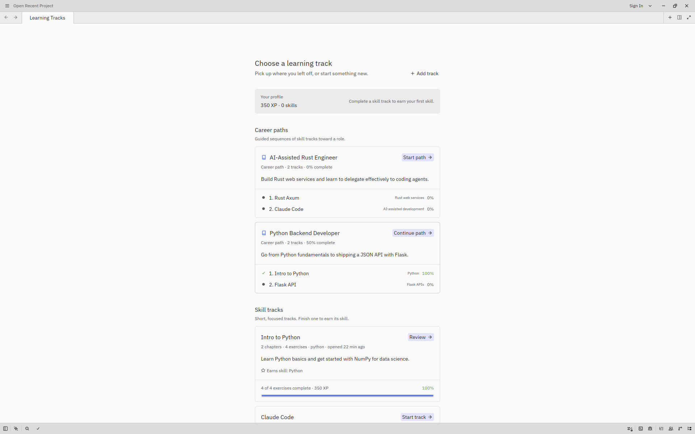
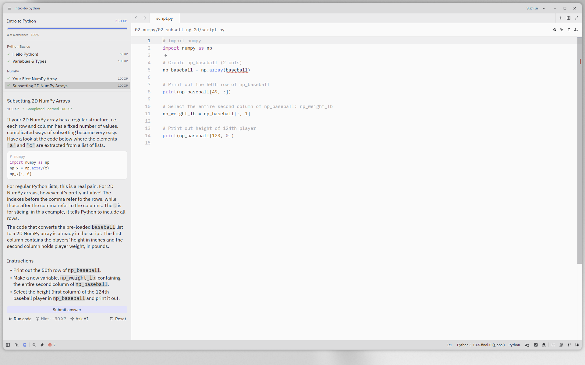
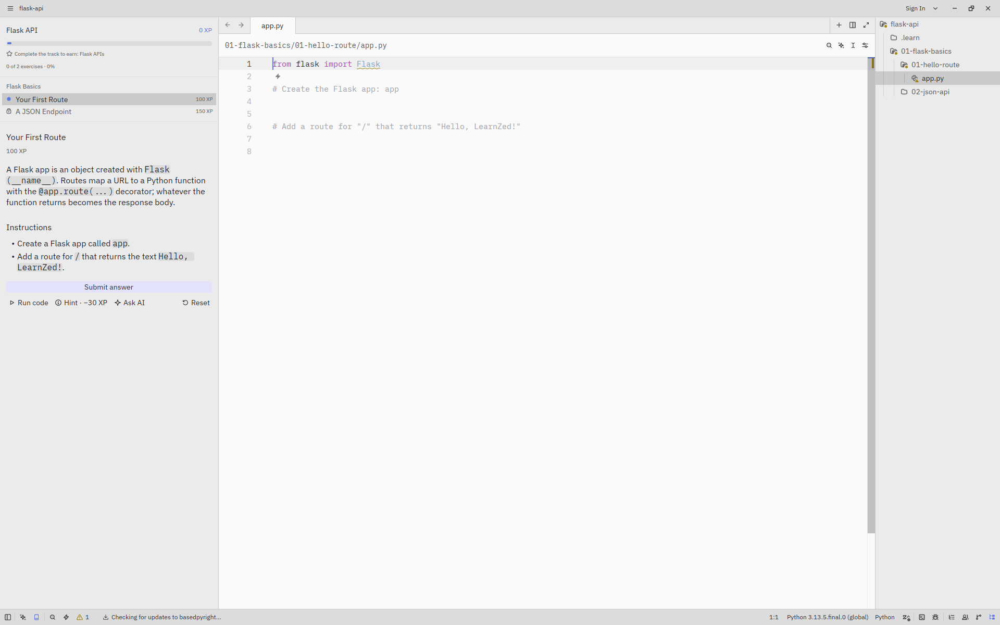
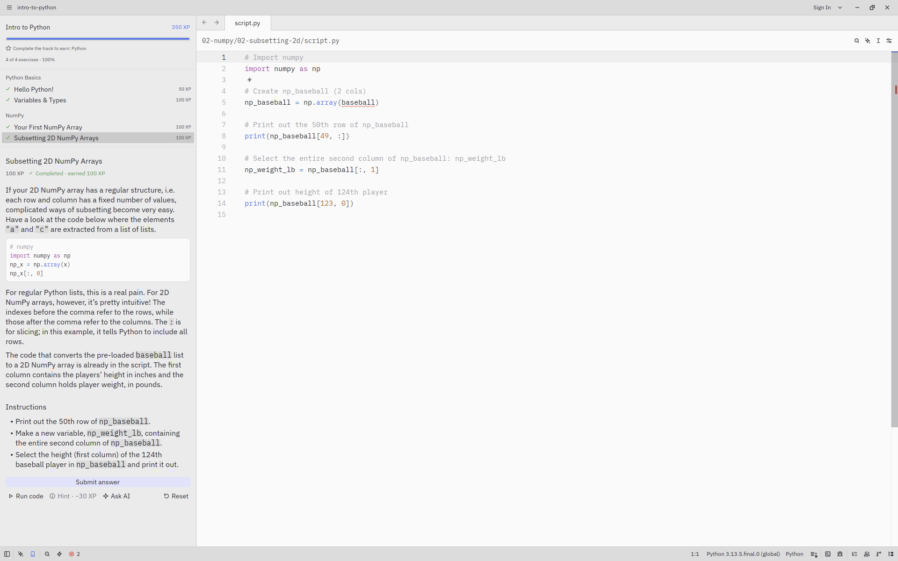
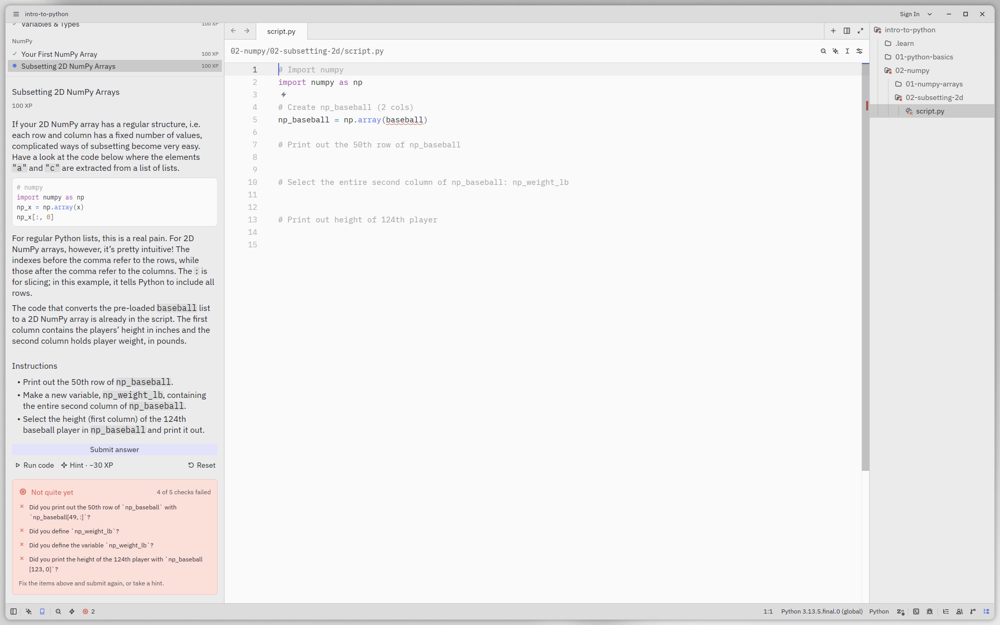
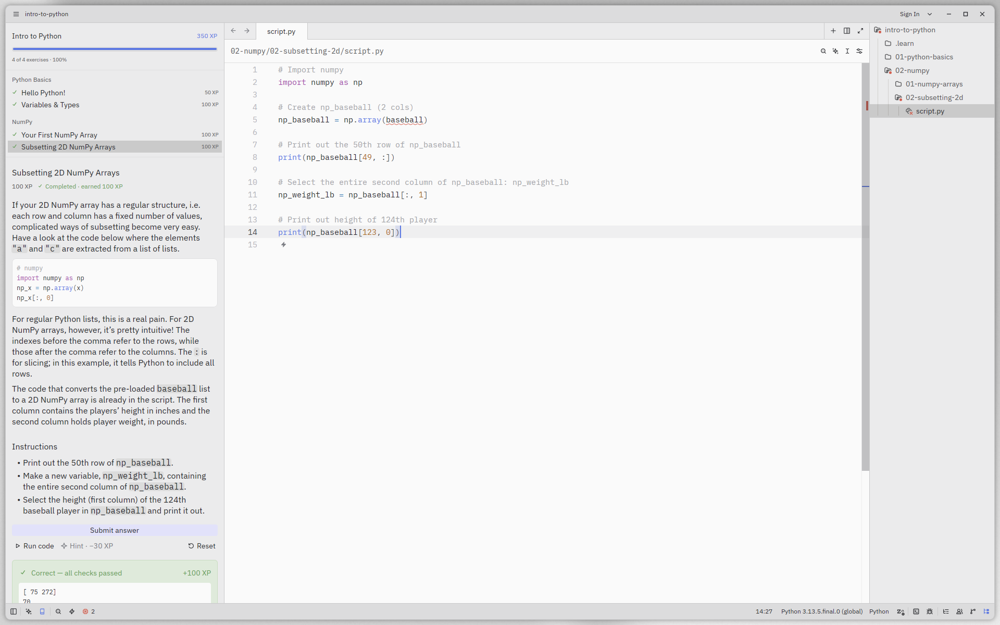
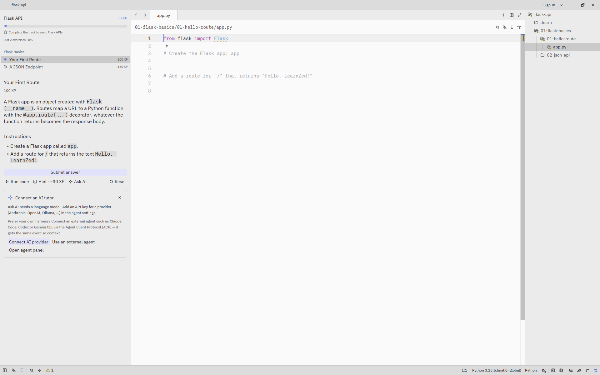
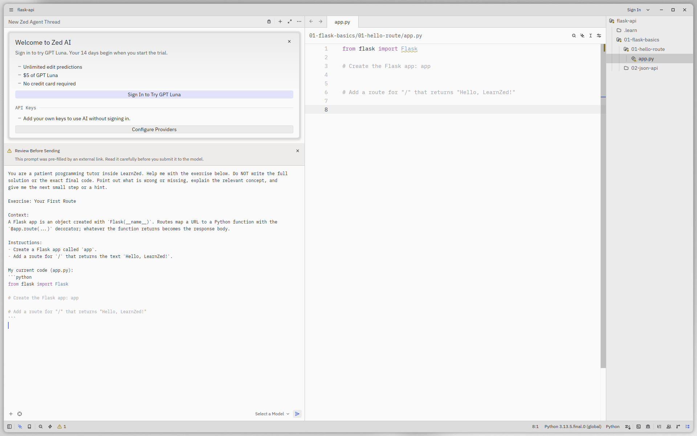

> [!IMPORTANT]
> Remove this line to confirm you've reviewed this PR before submitting.
<p align="center">
  
</p>

<h1 align="center">LearnZed</h1>

<p align="center"><b>Learn to code by writing real code in a real editor.</b></p>

LearnZed is an interactive learning app, similar to DataCamp, built on top of the [Zed](https://zed.dev) editor. You pick a **career path** or a **skill track** and work through short coding exercises inside a full code editor. **Run** your code to try it, then **Submit** it for an automated check. You earn **XP**, can unlock **hints** (they cost XP), and finishing a track gives you a **skill**. When you're stuck, **Ask AI** sends the exercise to Zed's built-in agent, or to your own agent such as Claude Code.

> Status: MVP / work in progress. Lives on the `learn/main` branch.

## Screenshots

| Pick a career path or skill track | Focused exercise layout |
|---|---|
|  |  |
| **Project layout (multi-file tracks)** | **Skill earned** |
|  |  |
| **Failed submit with feedback** | **Passed submit, XP awarded** |
|  |  |
| **Ask AI: connect a provider** | **Ask AI in the agent panel** |
|  |  |

## What's inside

- **Career paths**: ordered groups of tracks, e.g. *Python Backend Developer* and *AI-Assisted Rust Engineer*.
- **Skill tracks** that come bundled: *Intro to Python* (with NumPy), *Flask API*, *Rust Axum*, *Claude Code*.
- **Learn panel**: context, instructions, hints, plus *Run code*, *Submit answer* and *Ask AI* buttons.
- **Automated checks**: each exercise ships a `check.py` that inspects the output and code and returns friendly feedback.
- **Progress**: XP, completed exercises and earned skills are saved locally.
- **Layouts**: `focused` (just the exercise file and the Learn panel) or `project` (file tree shown, for multi-file work).
- **Your own tracks**: *Add track* imports a track from a local folder.

LearnZed keeps its config and data in separate `learnzed` directories, so it never touches an existing Zed install. The binary is called `learnzed`.

## Download

Prebuilt **unsigned** builds are attached to [GitHub Releases](https://github.com/ndolinschi/lzed/releases):

- Linux x86_64: `learnzed-linux-x86_64.tar.gz`
- macOS Apple Silicon: `learnzed-macos-aarch64.tar.gz` (unsigned, so run `xattr -dr com.apple.quarantine learnzed` before the first launch)
- Windows x86_64: `learnzed-windows-x86_64.zip` (unsigned, so SmartScreen may warn)

Exercises need Python 3 with `numpy`. Releases are built by `.github/workflows/learnzed_release.yml` when a `v*` tag is pushed.

## Quick start

Requirements: a Rust toolchain (via rustup), Zed's usual [build dependencies](docs/src/development), and **Python 3 with `numpy`** for the exercise checker (`pip install numpy`).

```sh
git clone -b learn/main https://github.com/ndolinschi/lzed.git
cd lzed
cargo run            # dev build, launches the track picker
```

Or run the dev binary directly with a throwaway data dir:

```sh
cargo build
ZED_ALLOW_EMULATED_GPU=1 target/debug/learnzed --user-data-dir /tmp/lz-data
```

(`ZED_ALLOW_EMULATED_GPU=1` is only needed on machines without a GPU.)

Run the learning core tests with `cargo test -p learn`.

## Track format

Bundled tracks live in `crates/learn/tracks/`, and career paths in `crates/learn/careers/`.

```
my-track/
  track.toml                # id, title, version, language, description, skill
  01-basics/
    chapter.toml            # title, order
    01-hello/
      exercise.toml         # id, title, xp, kind, language, file, hint_xp_cost, layout
      context.md            # background shown above the task
      instructions.md       # what to do
      hints.md              # hints, revealed one at a time
      starter.py            # initial contents of the exercise file
      solution.py           # reference solution
      setup.py              # optional pre-exercise code
      check.py              # automated checks
```

`exercise.toml` defaults: `xp = 100`, `kind = "coding"`, `language = "python"`, `file = "script.py"`, `hint_xp_cost = 30`, `layout = "focused"`. Set `layout = "project"` for multi-file or freestyle exercises.

`check.py` uses helpers from the runner (`crates/learn/runner/learn_runner.py`):

```python
check_output_contains("Hello, LearnZed!", "Did you print `Hello, LearnZed!` exactly?")
check_function_called("print")
```

A career path is a `career.toml`:

```toml
id = "ai-assisted-engineer"
title = "AI-Assisted Rust Engineer"
description = "Build Rust web services and learn to delegate effectively to coding agents."
tracks = ["rust-axum", "claude-code"]
```

### Authoring a track

1. Copy an existing track from `crates/learn/tracks/` and change the `id` and `title` in `track.toml`. Set `skill` to name the skill that finishing it awards.
2. Add chapters and exercises following the layout above.
3. Write `check.py` with clear, beginner-friendly failure messages, and check that `solution.*` passes.
4. Load it with **Add track** in the picker, or add it to the bundled tracks.

## Roadmap

- Import tracks from a git URL
- IPython-style REPL
- AI tutor tools inside the Zed chat: per-track `.rules`, exercise/check/hint tools, `/exercise`, `/check`, `/hint`, `/explain-error`
- UI tests for the picker and the Learn panel; update packaging scripts for the `learnzed` binary
- Auto-trust bundled tracks

## Credits & license

LearnZed is a fork of [Zed](https://github.com/zed-industries/zed) by Zed Industries; all editor credit goes to them. Like Zed, it is licensed under the GPL (see `LICENSE-GPL` and the other license files in this repository).
